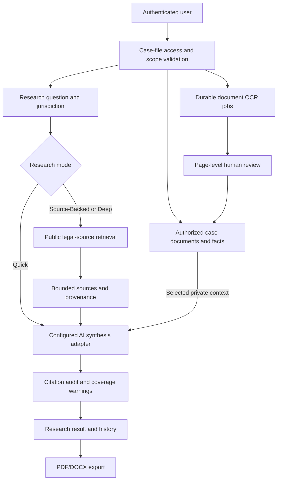

# Technical architecture and evidence controls

[Back to overview](../README.md)

The application is a Node.js/Express service backed by PostgreSQL, a storage location for uploaded files, and configured legal-source and model-provider integrations. The UI has public legal-methodology pages and an authenticated research workspace.

**Data-flow distinctions:** the public legal retrieval path receives the search question, while the synthesis adapter can receive selected private case-document context. This is a logical description, not an assertion that all data remains local.

## Controls represented in source

- **Scope resolution:** canonical precedence for jurisdiction and compatible court selection.
- **Case isolation:** user/firm/case ownership checks before research or linked-record operations.
- **Retrieval limits:** bounded source count and excerpt lengths to control payload size.
- **Citation audit:** marker and inline legal-citation comparison with the sources actually retrieved.
- **OCR durability:** claim leasing, retryable jobs, page-level records, quotas and acceptance.
- **Usage accounting:** guarded model calls with reservations, records and error paths.
- **Source labeling:** previous AI answers are not treated as primary case evidence in packet assembly.
- **Production configuration:** release readiness checks for database, auth, provider and persistent upload settings.

## Tradeoffs

This is a legal research and preparation workspace, not a law-practice management, full CLM, e-discovery, court-filing or case-outcome prediction platform. The current repository supports strong organizational workflows but does not itself establish audited compliance, legally complete retrieval, or provider zero-retention guarantees.

**Evidence:** `server.js`; `routes/research.js`; `routes/research_companion.js`; `services/locke_research_scope.js`; `services/research_engine.js`; `services/citation_audit.js`; `services/locke_research_ocr_jobs.js`; `services/locke_research_guard.js` at `205a11c`.
